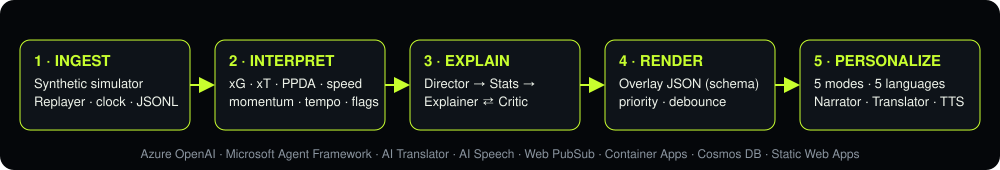
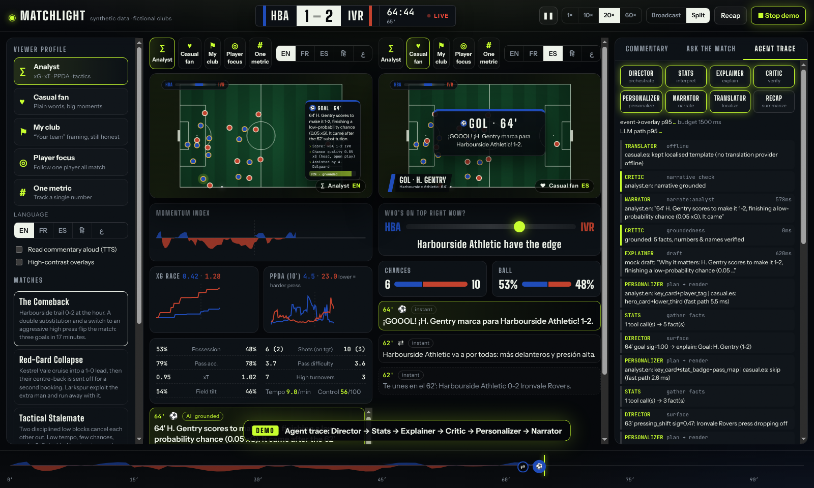
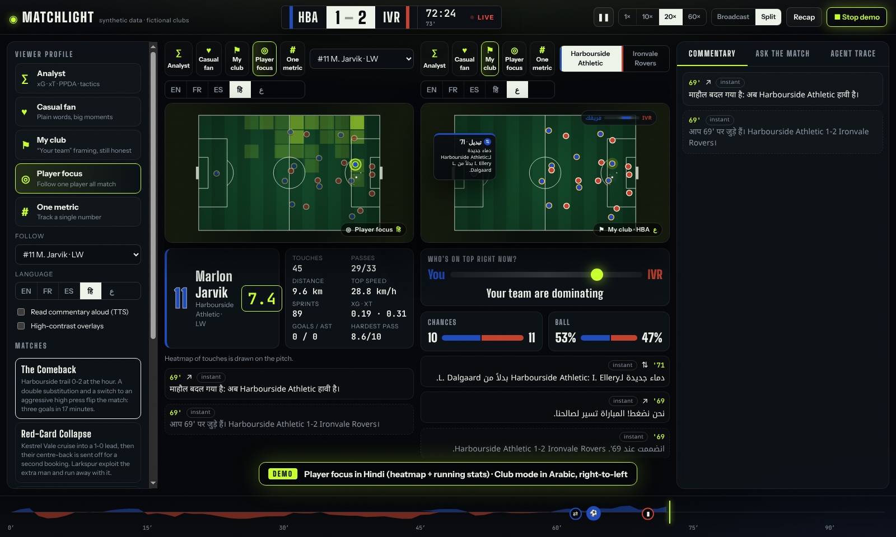
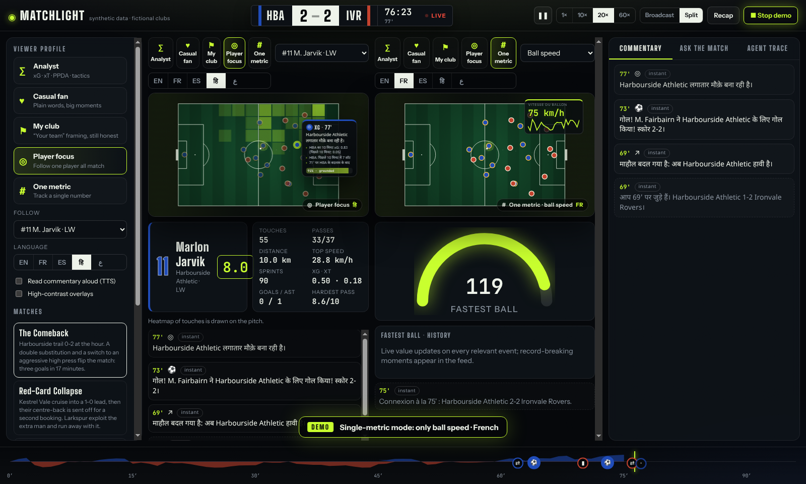
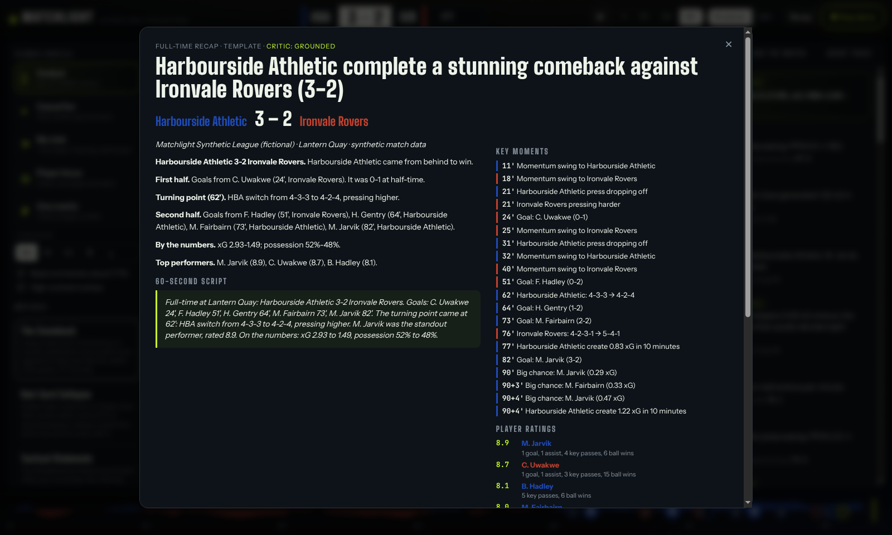

# Matchlight

**A multi-agent match intelligence engine.** Matchlight turns a live stream of _synthetic_ football events into explainable insight, timed broadcast overlays, personalised fan experiences, multilingual narration and an automated recap.

> Built for the **Microsoft × Premier League "Inside the Game" Developer Hackathon**.
> **100% synthetic data:** fictional clubs, players, stadiums and competition. No real league data, logos, crests, trademarks or music anywhere.

|                                               |                                                                                                                            |
| --------------------------------------------- | -------------------------------------------------------------------------------------------------------------------------- |
| **Pitch**                                     | [PITCH.md](PITCH.md)                                                                                                       |
| **2-minute demo script**                      | [DEMO_SCRIPT.md](DEMO_SCRIPT.md) (press **★ Demo mode** in the app, or open `/?demo=1`)                                    |
| **Architecture, data model, agent contracts** | [docs/ARCHITECTURE.md](docs/ARCHITECTURE.md) · [docs/DATA_MODEL.md](docs/DATA_MODEL.md) · [docs/AGENTS.md](docs/AGENTS.md) |
| **Deploy to Azure**                           | [docs/DEPLOY.md](docs/DEPLOY.md) (`azd up`)                                                                                |
| **How each judging criterion is met**         | [docs/RUBRIC.md](docs/RUBRIC.md)                                                                                           |

---

## What it does

The same event stream becomes **genuinely different broadcasts** for different viewers:

- **Analyst:** xG, xT, PPDA, momentum and control-vs-chaos charts, pass maps, and evidence-backed key-moment cards with Critic-verified confidence.
- **Casual fan:** plain words, emotion and analogies, at most one number per line (enforced by the Critic agent), and big hero cards for goals.
- **My club:** "your team" framing. Your team's moments are boosted, and the opponent's goals are still reported honestly.
- **Player focus:** follow one player all match with a live heatmap, running stats, milestones, 10-minute updates and a personal mini-recap.
- **One metric:** track only ball speed, pass difficulty, top speed, xG, PPDA, momentum or tempo.
- **Five languages** (English, Français, Español, हिन्दी, العربية with full RTL), plus optional text-to-speech.

Every narrative is **grounded**. The Explainer must cite facts (`{claim, evidence[], confidence, event_ids[]}`), and a Critic agent rejects any number, player name or "rose/fell" claim the data doesn't support, then asks for a regeneration. The Agent Trace panel shows this happening live.



| Analyst broadcast (EN) vs casual fan (ES), with the agent trace live | Player focus (हिन्दी) + My club (العربية, RTL)          |
| -------------------------------------------------------------------- | ------------------------------------------------------- |
|                        |   |
| **Single-metric mode (FR) · pinned ball-speed badge**                | **Automated recap: article, script, timeline, ratings** |
|                                   |                             |

## The five-stage pipeline

| Stage              | Module                                                                                     | What happens                                                                                                                                                                                                                                                                                                                              |
| ------------------ | ------------------------------------------------------------------------------------------ | ----------------------------------------------------------------------------------------------------------------------------------------------------------------------------------------------------------------------------------------------------------------------------------------------------------------------------------------- |
| 1. **Ingest**      | [`simulator/`](simulator), [`pipeline/src/ingest`](pipeline/src/ingest)                    | Seeded match engine (possession chains, formations, pressing, momentum, fatigue, tactical shifts, set pieces, cards, subs) emits schema-validated events and 1 Hz tracking. A replayer streams them "as they happen" on a simulated clock (1×/10×/20×/60×, seek, rewind). Streams are exported as replayable JSONL.                       |
| 2. **Interpret**   | [`pipeline/src/interpret`](pipeline/src/interpret)                                         | Streaming aggregator (~0.01 ms/record): possession, xG, xT-style threat, pass difficulty, ball/shot/player speed, distance, sprints, PPDA (and rolling PPDA), momentum index, tempo, control-vs-chaos, live ratings, heatmaps, and threshold flags such as "top speed 31.8 km/h", "PPDA 9.0 → 2.7" or "momentum swing".                   |
| 3. **Explain**     | [`agents/src`](agents/src) (`director`, `stats-agent`, `explainer`, `critic`)              | Director scores significance (cooldowns, repetition). Stats agent gathers facts via tools. Explainer drafts, and the Critic verifies, rejects and regenerates, falling back to a grounded template. An optional **Microsoft Agent Framework** workflow sidecar ([`agents-maf/`](agents-maf)) can run the Explainer ⇄ Critic loop instead. |
| 4. **Render**      | [`pipeline/src/render`](pipeline/src/render), [`overlay-schema/json`](overlay-schema/json) | Timed, machine-readable overlay JSON (lower-thirds, player tags, stat badges, momentum bar, pass maps, key-moment cards) with `start_ts`, `duration`, `priority`, title-safe `position`, `language`/`dir`. JSON Schema validated. A priority and debounce scheduler keeps the screen uncluttered.                                         |
| 5. **Personalize** | [`agents/src`](agents/src) (`personalizer`, `narrator`, `translator`, `renderer`)          | Profile → content selection and format. Persona-conditioned narrator, glossary-pinned translation (Azure AI Translator dynamic dictionary), localised offline templates, TTS.                                                                                                                                                             |

Also included: **Recap agent** (article, 60-second script, timeline, player ratings; export Markdown/JSON/MP3), **Ask the match** (grounded Q&A with tool calling), and an **auto-eventing stub** that derives passes and sprints from tracking coordinates alone ([`pipeline/src/autoevent`](pipeline/src/autoevent), clearly labelled experimental: 58% precision, 43% recall at 1 Hz).

## Microsoft / Azure hero technologies

| Need                                                                  | Azure service                                                                                                                         | Where                                                                                   |
| --------------------------------------------------------------------- | ------------------------------------------------------------------------------------------------------------------------------------- | --------------------------------------------------------------------------------------- |
| LLM reasoning (Explainer, Narrator, Recap, Ask, translation fallback) | **Azure OpenAI in Azure AI Foundry** (`gpt-4o-mini`, structured outputs + tool calling, keyless Entra ID)                             | [`agents/src/runtime/llm.ts`](agents/src/runtime/llm.ts)                                |
| Agent orchestration                                                   | **Microsoft Agent Framework** workflow (Explainer agent ⇄ Critic executor graph) + a TypeScript agent runtime with the same contracts | [`agents-maf/`](agents-maf), [`agents/src/orchestrator.ts`](agents/src/orchestrator.ts) |
| Multilingual narrative                                                | **Azure AI Translator** (dynamic-dictionary glossary + `notranslate` for names)                                                       | [`agents/src/translator.ts`](agents/src/translator.ts)                                  |
| Commentary + recap audio                                              | **Azure AI Speech** neural TTS (5 locales)                                                                                            | [`api/src/tts.ts`](api/src/tts.ts)                                                      |
| Real-time push                                                        | **Azure Web PubSub** (groups per match and per profile; least-privilege client tokens)                                                | [`api/src/transport`](api/src/transport)                                                |
| Backend                                                               | **Azure Container Apps** (API + agents; MAF sidecar internal-only)                                                                    | [`infra/resources.bicep`](infra/resources.bicep)                                        |
| State                                                                 | **Azure Cosmos DB** serverless (events in 200-event chunks, explanations, recaps)                                                     | [`api/src/store/cosmos-store.ts`](api/src/store/cosmos-store.ts)                        |
| Frontend                                                              | **Azure Static Web Apps**                                                                                                             | [`web/`](web)                                                                           |
| Ops                                                                   | Managed identity, Container Registry, Log Analytics + Application Insights, **azd** + Bicep                                           | [`infra/`](infra), [`azure.yaml`](azure.yaml)                                           |

**Local-dev fallback:** with no Azure settings, Matchlight runs fully offline. It uses a deterministic mock LLM with simulated latency (which deliberately injects some wrong drafts so you can watch the Critic catch them), localised templates in all five languages, a local Web PubSub _emulator_ that speaks the same `json.webpubsub.azure.v1` protocol, browser speech synthesis and an in-memory store.

## Quick start

```bash
# Requirements: Node 20+ (22 recommended). Optional: Docker, Python 3.10+ (MAF sidecar), azd (deploy).
npm ci
npm run dev            # API on :8787 + web on :5173  →  http://localhost:5173
# or
make docker            # docker compose up --build    →  http://localhost:8787
```

Press **★ Demo mode** for the scripted 90-second tour, or pick a match / "Generate new match" in the left panel.

```bash
npm test               # 63 TypeScript tests (unit, schema, seeded replay, golden overlays, agents, API integration, MAF contract)
npm run check          # prettier + eslint + tsc + tests (what CI runs)
npm run simulate -- red-card-collapse   # write data/runs/red-card-collapse-default.jsonl
cd agents-maf && pip install -e '.[dev]' && pytest     # Microsoft Agent Framework workflow tests (offline)
```

Configuration is via environment variables; see [`.env.example`](.env.example). No secrets are committed. In Azure, everything except the Translator and Speech keys uses managed identity (those two keys are stored as Container Apps secrets).

## Repository layout

```
overlay-schema/   Zod contracts shared by every service + generated JSON Schemas (overlay-schema/json, symlinked as /schema)
simulator/        Seeded synthetic match engine, scenarios, 1 Hz tracking, JSONL CLI
pipeline/         ingest/ (clock, replayer, JSONL, validation) · interpret/ (stats engine, xG/xT/difficulty) · render/ (overlay builder, scheduler) · autoevent/
agents/           Agent runtime (LLM providers, tools, trace, shared memory) + Director, Stats, Explainer, Critic, Narrator, Personalizer, Translator, Renderer, Recap, Ask, Orchestrator
agents-maf/       Python Microsoft Agent Framework workflow sidecar (Explainer ⇄ Critic)
api/              Node HTTP API, session loop, Web PubSub (Azure + local emulator), Cosmos DB store, Speech TTS
web/              React + Vite broadcast UI (canvas pitch, DOM overlays, split view, trace, ask, recap, demo mode)
infra/            Bicep for azd (Container Apps, Static Web Apps, OpenAI, Translator, Speech, Web PubSub, Cosmos DB, ACR, Log Analytics)
docs/             Architecture, data model, agent contracts, deploy guide, rubric self-assessment
tests/            Vitest suites + golden files
```

## Why TypeScript for the agents (and Python for MAF)

The latency budget (under 1.5 s from event to overlay) and the "same contracts everywhere" goal decided it. One Zod schema package types the simulator, stats engine, agents, API, overlay JSON Schema and the React client, so a contract change is a compile error rather than a production bug. The agents run in-process with the stats engine: the fast path (stats → Director → facts → template narration → overlays) measures **p95 ≈ 4 ms**, and LLM work runs asynchronously and _supersedes_ the template line when it passes the Critic. Microsoft Agent Framework's GA SDKs are Python and .NET, so the Explainer ⇄ Critic loop is also provided as a real MAF workflow ([`agents-maf/`](agents-maf)). Set `MAF_ENDPOINT` and the TS orchestrator delegates to it, re-verifying its output in-process.

## Data & IP

All clubs (Harbourside Athletic, Ironvale Rovers, Kestrel Vale…), players (randomly combined fictional names), stadiums, referees and the "Matchlight Synthetic League" are invented. No real Premier League data, names, logos, crests, trademarks or copyrighted music are used in code, assets or the demo. Fonts are open-licence (Google Fonts) and icons are Unicode glyphs.

## License

[MIT](LICENSE)
