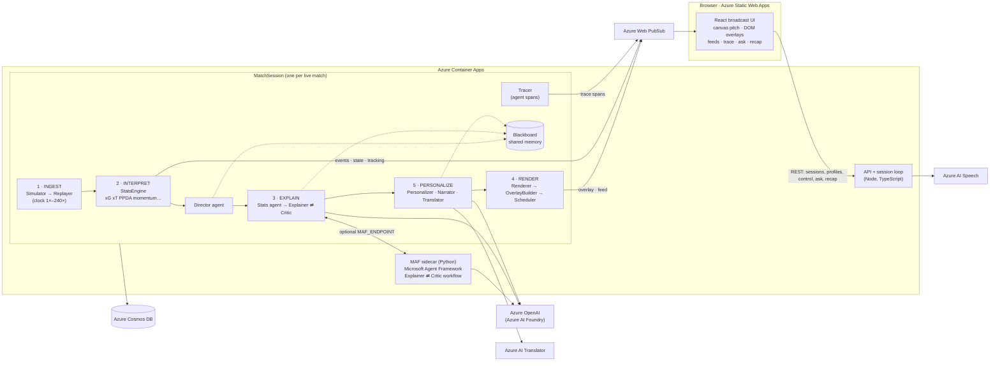

# Architecture

## System view



**Groups.** Each match publishes to a shared Web PubSub group `match.<session>` (events, tracking, state, clock, moments, explanations, trace spans, recaps). Each viewer profile has its own group `match.<session>.<profileKey>` (overlays, feed items, answers). Personalised work is done once per _distinct_ profile, not once per viewer, so 10,000 casual-French viewers cost the same as one.

**Local mode.** `LocalHub` emulates Web PubSub's `json.webpubsub.azure.v1` client protocol over a plain WebSocket, so the browser code is identical in both environments. The client negotiates a token for exactly the groups it needs (least privilege), and re-negotiates when a new profile group is added.

## Event → overlay sequence (fast path + async LLM path)

```mermaid
sequenceDiagram
  autonumber
  participant R as Replayer (clock)
  participant S as StatsEngine
  participant D as Director
  participant St as Stats agent
  participant P as Personalizer/Narrator/Renderer
  participant Sc as Scheduler
  participant H as Web PubSub
  participant X as Explainer (LLM)
  participant C as Critic
  participant T as Translator

  R->>S: event (validated)
  S-->>D: flags (e.g. PPDA 9.0 → 2.7)
  D->>D: significance, cooldown, repetition
  D->>St: moment
  St->>St: tools: team_window, compare_windows, recent_turnovers…
  St-->>P: facts[] (each with event_ids)
  P->>P: per profile: plan → template line (localised) → Critic persona check
  P->>Sc: overlays (card, badge, tag, pass map…)
  Sc->>H: show / update / clear  (p95 ≈ 4 ms after the event)
  Note over X,C: async; never blocks the fast path
  D-)X: explain(moment, facts)
  loop up to 3 attempts
    X->>C: draft {claim, evidence[], confidence, event_ids[]}
    C-->>X: rejected: "7" not backed by any fact
  end
  C-->>P: grounded explanation
  P->>X: Narrator (persona style)
  P->>C: narrative check (numbers, names, persona limits)
  P->>T: translate (glossary pinned) → Critic number re-check
  P->>H: feed item {supersedes: template line} + card updated in place
```

**Latency budgets** (measured live in the Agent Trace panel and asserted in tests):

| Path                                                                                      | Budget                                            | Measured (mock LLM, laptop)                                           |
| ----------------------------------------------------------------------------------------- | ------------------------------------------------- | --------------------------------------------------------------------- |
| Event → overlay (fast path: stats, director, facts, template narration, render, schedule) | < 1,500 ms                                        | p50 ≈ 1.3 ms, p95 ≈ 4 ms                                              |
| LLM narrative replaces template line                                                      | `NARRATIVE_BUDGET_MS` (6 s) or the template stays | depends on model; slow answers are discarded and traced as `fallback` |

## Determinism & replay

Every random decision in the simulator flows through one seeded PRNG (`mulberry32`) with forked sub-streams, so a `(scenario, seed)` pair yields a byte-identical JSONL stream (tested with SHA-256). The pipeline is also deterministic: the golden-file test replays the seeded comeback through all five stages with the mock LLM and compares every overlay (id, timing, priority, region, text) against [`tests/golden/late-comeback.overlays.json`](../tests/golden/late-comeback.overlays.json).

Seeded scenarios use scripted _beats_ (e.g. "away goal ~23'", "home double sub 61'", "switch to 4-2-4 with an all-out press") layered on the emergent simulation, so each story is guaranteed while everything between the beats is simulated. `random` scenarios are fully emergent.

## Scaling notes

- A session is single-writer and in-memory. The Container App runs one replica (`maxReplicas: 1`), which is enough for a hackathon. For production, shard sessions by id with Container Apps session affinity, or move the replayer into Azure Functions Durable Entities.
- Web PubSub fans out to any number of viewers. The server publishes once per group per 100 ms tick (batched arrays, chunked at 200 messages).
- Cosmos DB writes events in 200-event chunks (about 11 writes per match) to keep serverless RU cost negligible.

## Security

- Synthetic data only, no PII.
- Managed identity everywhere it is supported (Azure OpenAI with local auth disabled, Web PubSub, Cosmos DB data-plane RBAC, ACR pull). Translator and Speech keys live as Container Apps secrets.
- Web PubSub client tokens are scoped to the session's own groups. The local emulator enforces the same rule (tested).
- Request bodies are Zod-validated and capped at 64 KB; questions are limited to 300 chars; sessions are capped and reaped after 30 idle minutes.
- The Critic is a _safety_ layer as well as a quality layer: nothing reaches a viewer unless every number and player name traces to data.
