# Screenshots

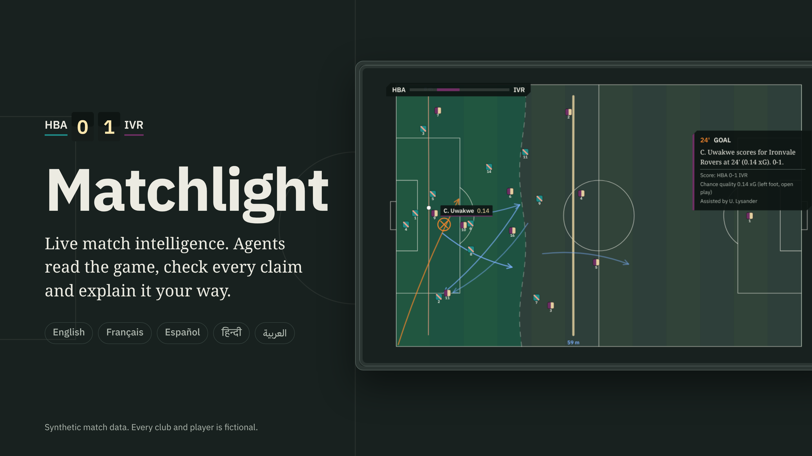

Screenshots of the Matchlight web client running on synthetic match data. Every club, player and kit is fictional.

Desktop shots are 1440 × 900. Mobile shots are 390 × 844 at 2× density.

## Channels

| Analyst                                 | Fan                                 |
| --------------------------------------- | ----------------------------------- |
| 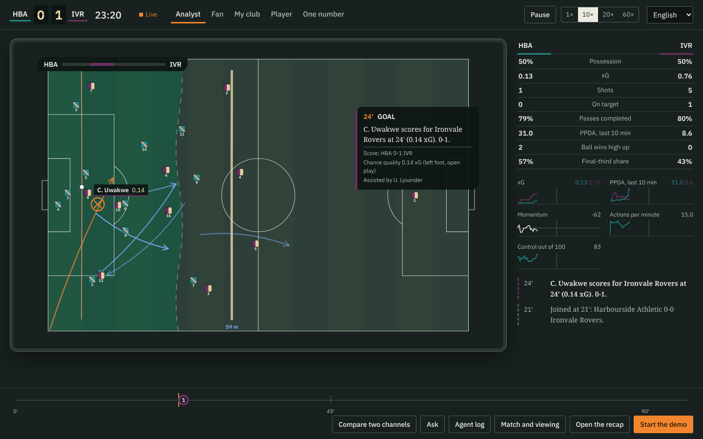   | 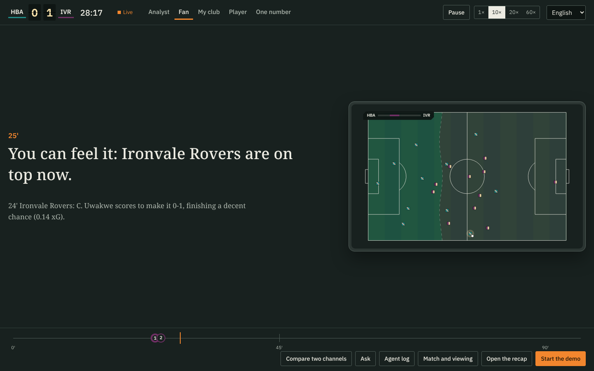       |
| **Player focus**                        | **One number**                      |
| 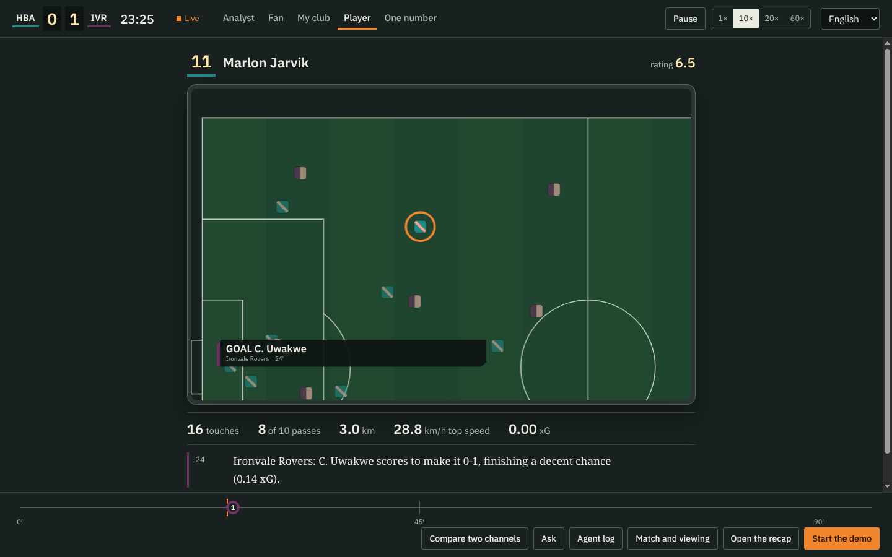 | 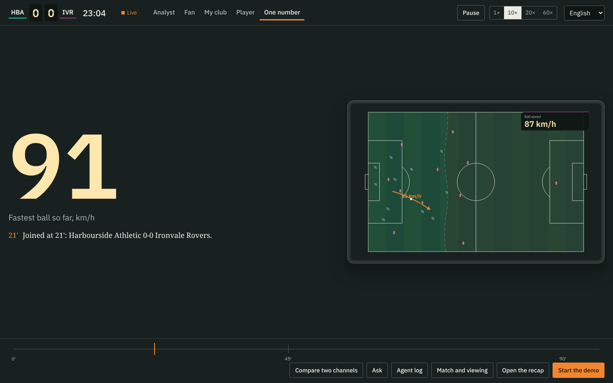 |

## Arabic and Hindi

Arabic flips the whole layout, including the timeline and the overlays.

| Analyst in Arabic                                   | My club in Arabic                               |
| --------------------------------------------------- | ----------------------------------------------- |
| 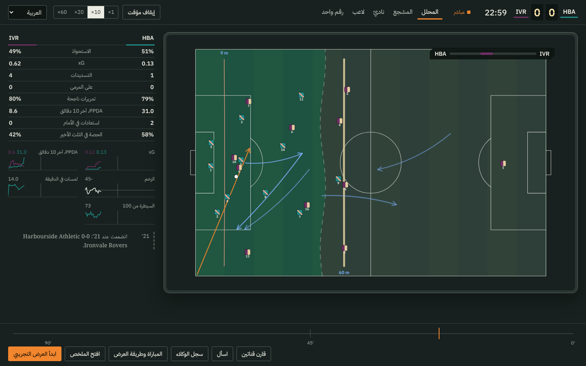     | 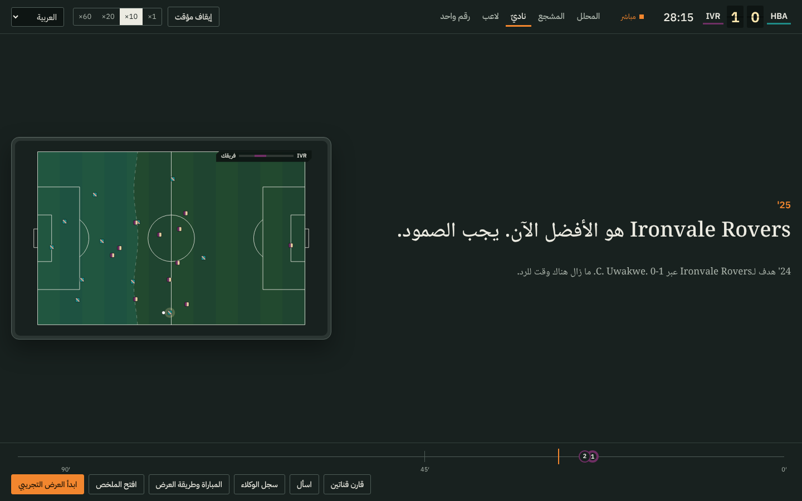 |
| **Player focus in Hindi**                           | **Two channels side by side**                   |
| 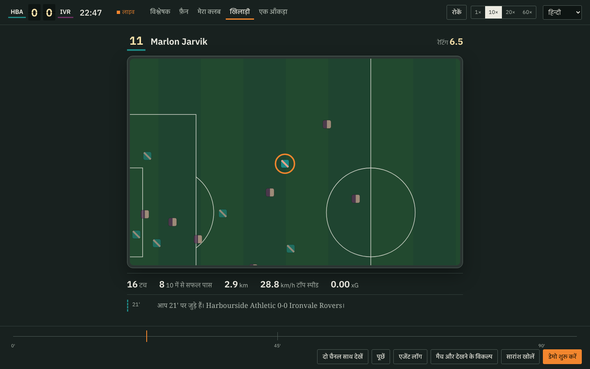 | 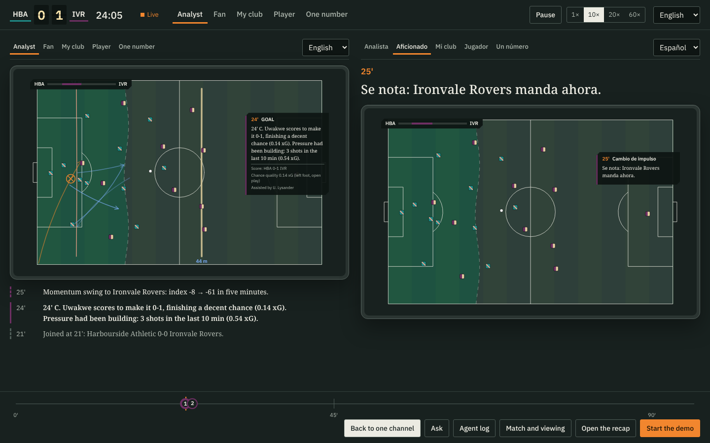    |

## Agent log and recap

| Agent log                      | Recap                  |
| ------------------------------ | ---------------------- |
| 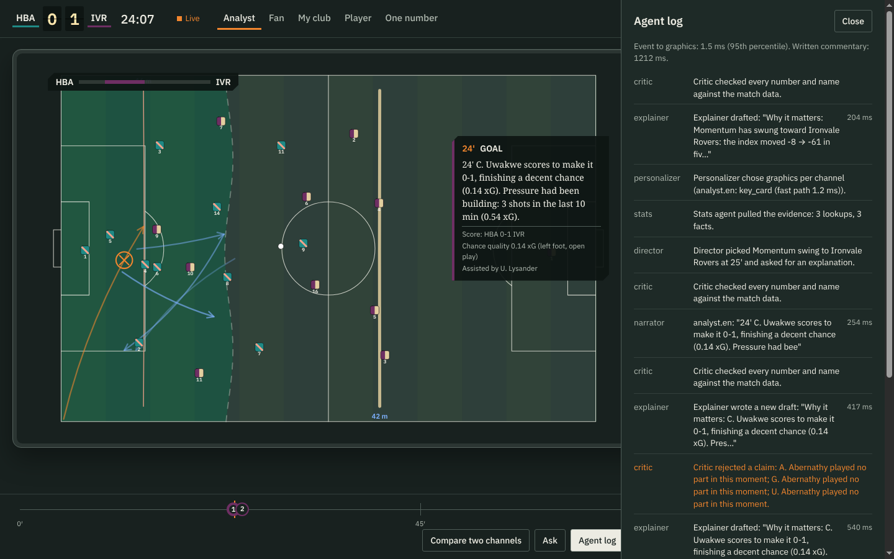 | 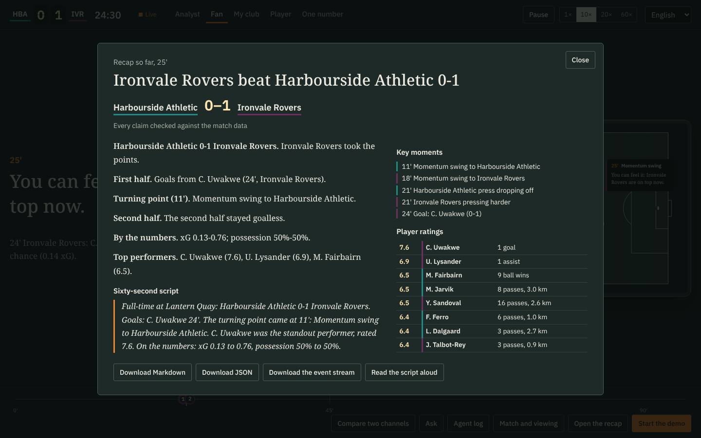 |

## Mobile

| Fan                                 | Analyst in Arabic                                         | One number in Hindi                                           |
| ----------------------------------- | --------------------------------------------------------- | ------------------------------------------------------------- |
| 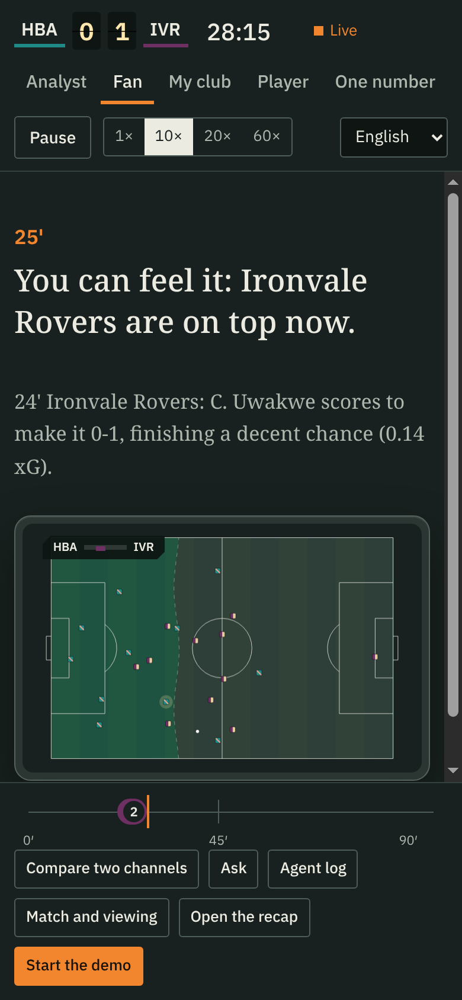 | 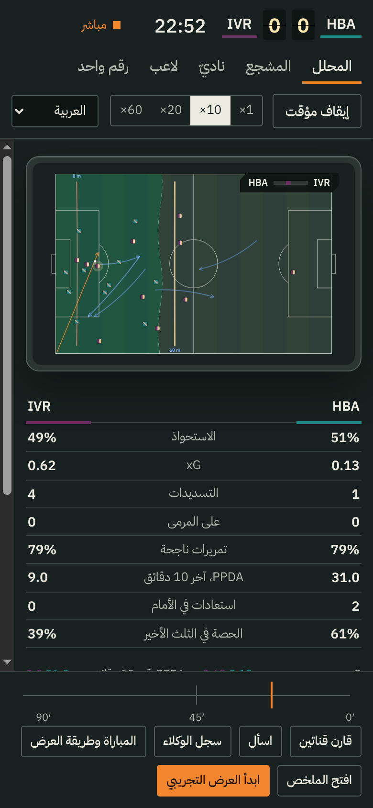 | 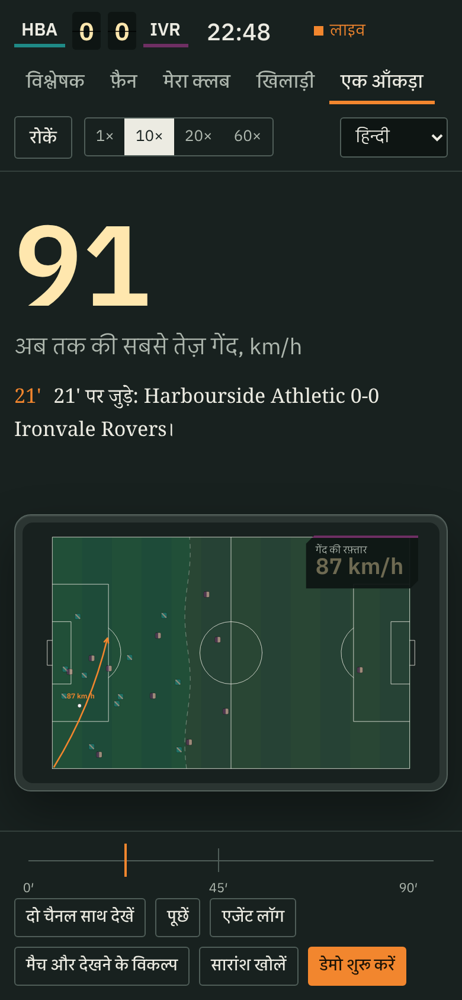 |
